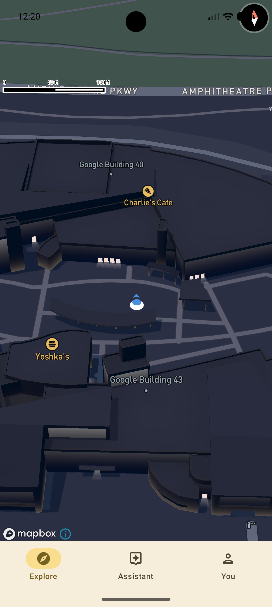

# PMap
The first fully open source and intelligent map app, built to be better than Google Maps

> [!WARNING]
> This project is a WIP. This is just a rough base build. Most of the features do not work yet. If you are here to use the project, please wait for the first preview release.

## Our goal
To make a fully working open source map app that exceeds Google Maps' functionality:
- AI route planning(homelab)
- Lane level navigation
- Great visuals!

## Features
| Feature | Description |
| :-- | :-- |
| Modern map display | The most modern & precise map you'll ever see |
| BYOK Architecture | Bring your own key onboarding for both Mapbox and HERE |
| Real time lighting | The best visuals and graphics you'll ever see. Adjusts map lighting based on the local sunrise/sunset times of the area you're browsing | 

## Engines used
| Feature | Engine |
| :-- | :-- |
| Map Renderer | [Mapbox](https://www.mapbox.com/mobile-maps-sdk) |
| Lane Level navigation | [HERE](https://www.here.com/products/here-navigation)(Evaluation in Progress) |

## Authentication, Quotas, Keys, and installation
> [!IMPORTANT]
> PMap is developed by PeterMaZep, an indie open source developer. This means PMap will always be free, but its SDKs may not be. For example, Mapbox and HERE both require keys and (maybe) subscriptions. Their free plan only supports up to 5,000 MAU effectively (HERE is the shortest plank in this project. If you are only planning to use the map feature (without navigation), the effective MAU is actually 25,000 users).

There are 2 ways to use this project:
1. **BYOK in app** - Entering your Mapbox and HERE key into the app as part of the onboarding process.
    * Go to [Github Releases](https://github.com/PeterMaZep/PMap/Releases)
    * Download the latest APK file
    * Install the APK file
    * Enter your API keys in the onboarding process

2. **Becoming your own provider** - You can distribute the software to other people who do not want to go through the hassle of making an account on the platforms and getting an API key.
    * Clone this repository.
      ```bash
       git clone https://github.com/PeterMaZep/PMap.git
       cd PMap
      ```
    * Then, enter your keys into key.txt in the following format:
      ```text
       pk.mapboxKeyHere
       HEREAccessKeyID, HEREAccessKeySecret
      ```
    * Then, add your signing keys.
        * Open local.properties and add your signing details:
        ```properties
          RELEASE_STORE_FILE=/path/to/your/keystore.jks
          RELEASE_STORE_PASSWORD=your_password
          RELEASE_KEY_ALIAS=your_alias
          RELEASE_KEY_PASSWORD=your_key_password
        ```
    * Finally, build the project.
        * You can either use Android Studio to build, or you can use the terminal:
        ```bash
         ./gradlew assembleRelease
        ```
        * The resulting APK will be at `app/build/outputs/apk/release/app-release.apk`
    * You are free to distribute it as long as:
        - You must include the original copyright notice and comply with the Apache 2.0 License.
        - You are under 5000 MAU(If you are on the free plan)
        - You are paying for the SDK(If you exceed the free plan's limits)

> [!NOTE]
> If you are a casual user, I would recommend using the first way. If you want to distribute the app to your family and friends, I would recommend becoming your own key provider.

## Roadmap
| Feature | Status | Description/Notes |
| :-- | :-- | :-- |
| Full onboarding process | ❌ | A fully working onboarding process with the BYOK section including all the SDKs |
| Modern Lane Level Navigation | ❌ | Fully working modern lane level navigation using HERE SDK |
| Intelligent Route planning | ❌ | Route planning using AI technology to match your preferences |
| POI Search | ❌ | To provide an even more modern map search engine that uses AI to rank results |
| Local AI model | ❌ | This feature is difficult to implement and should not be expected to come soon |

## Screenshots


<!--
## Repository Activity
\
-->

> [!NOTE]
> Copyright 2026 PeterMaZep
> Distributed under the Apache 2.0 License. See LICENSE for more information.
